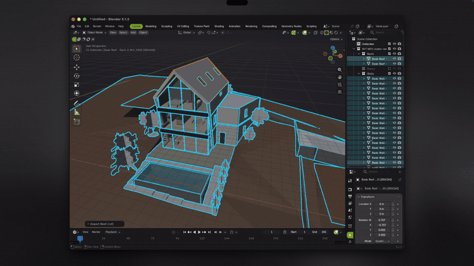

# Blender Revit Bridge

Import Autodesk Revit **`.rvt`** files straight into Blender, **no Revit installation needed**.
Works on macOS (Apple Silicon and Intel), Linux and Windows hosts.

`File › Import › Revit (.rvt)`

[](docs/demo.mp4)

▶️ [Watch the full demo (1:48, MP4)](docs/demo.mp4)

## Features

- **Direct `.rvt` import** for files saved with Revit 2016 to 2027. Conversion runs in the background and `ESC` cancels it.
- **BIM structure kept:**
  - Collections by **Category**, **Level**, or **Level › Category**.
  - Objects named `Family - Type [ElementId]`.
  - Every Revit parameter stored as a Custom Property (`revit_category`, `revit_level`, `rvt: …`).
- **Real Revit material names and colours.**
- **Auto-texture**:
  - Each Revit material name is matched to a CC0 PBR texture set from [ambientCG](https://ambientcg.com), for example `Holz` › wood, `Stahlbeton` › concrete, `Dachziegel` › roof tiles, `Glas` › glass. Keywords cover English, German and Persian.
  - The set is downloaded at the quality you choose (**1K / 2K / 4K / 8K**) and applied with **metric box-projected UVs** (`RevitBoxUV`), so it works in Solid, Material Preview, Rendered and FBX/glTF export.
  - Textures are cached in a local library and reused across projects.
  - The original Revit colour can be blended over the texture (`Revit colour tint`).
  - When the converter could not resolve a material, it is guessed from the element's type and category (walls › plaster, slabs › concrete, and so on).
- **Isolate far elements.** Stray survey points or lost families kilometres away go into a hidden `_Far Elements` collection, so `Frame All` works.
- **Hide helpers.** Rooms, Mass and Areas volumes are excluded from view and render by default.
- **Remote converter (optional).** When the local converter fails, the file is converted on a Windows machine over SSH with the newer Windows build, then pulled back automatically.

## Requirements

1. **Blender 4.2+** (tested on 5.1.2).
2. **DDC converter.** This add-on drives the free DDC converters by
   [DataDrivenConstruction](https://github.com/datadrivenconstruction/cad2data-Revit-IFC-DWG).
   The converter is **not included** here. Download it yourself:
   - **macOS / Linux:** `rvt-decode-<version>-<platform>.tar.gz` from the
     [releases](https://github.com/datadrivenconstruction/cad2data-Revit-IFC-DWG/releases).
     Verify it against `SHA256SUMS.txt` and unpack it into
     `~/Library/Application Support/BlenderRevitBridge/` (macOS) or
     `~/.local/share/blender-revit-bridge/` (Linux). On macOS, also run
     `xattr -dr com.apple.quarantine <folder>`.
   - **Windows (remote mode):** `DDC-RVT-Converter-<version>-portable.zip`, unpacked anywhere.

> ⚠️ **Licence of the converter:** DDC converters are proprietary and **free for non-commercial use only**.
> Paid or client work needs a licence from DataDrivenConstruction (info@datadrivenconstruction.io).
> This add-on (GPL-3.0) is independent and is not affiliated with Autodesk or DataDrivenConstruction.

## Install

1. Download `blender-revit-bridge-<version>.zip` from Releases, or zip the `revit_importer/` folder yourself.
2. In Blender, go to `Edit › Preferences › Get Extensions › ⌄ › Install from Disk…`.
3. Open the add-on preferences and check that **rvt-decode binary** points to the converter.
   The add-on finds it automatically if it is unpacked in the folder listed above.

Or build from source:

```bash
blender --command extension build --source-dir revit_importer --output-dir .
blender --command extension install-file -r user_default -e revit_importer-*.zip
```

## Usage

- `File › Import › Revit (.rvt)` opens the import options: decoder, Revit materials, organize, parameters, auto-texture and quality, far elements.
- Sidebar `N › Revit`:
  - `Texture All` / `Selected`
  - `Swap Texture` (tries the next match)
  - `Revert` to the Revit colour
  - per-material tint slider

### Decoder modes

- **Auto** (default): local converter first, then the remote converter if it is enabled.
- **Local:** fast, runs on this machine.
- **Remote (Windows):** upload over SSH, run `RVTconverter.exe`, download the GLB and the element table, and clean up the remote job folder. To use it, enable it in the preferences and set the SSH host alias (key-based login), the path to `RVTconverter.exe` and a work folder.
- **Legacy GLB:** old experimental decoder, geometry only. Last resort.

## Known limitations

- **Textures are stand-ins, not the original Revit textures.** `.rvt` files only reference
  Autodesk's material library and do not contain the bitmaps.
- **Converter versions differ by platform.** The macOS CLI build can lag behind the Windows/Linux builds.
  Older builds fail on some large files with `corrupt gzip stream`; use the remote mode or a newer build.
- **Box-projected UVs** can look slightly stretched on steep diagonal terrain.
- **Material matching is keyword-based.** Use `Swap Texture` when a match is off.

## Credits

- Conversion: DDC converters © DataDrivenConstruction (separate licence, see above).
- Textures: [ambientCG](https://ambientcg.com) (CC0).
- Autodesk and Revit are trademarks of Autodesk, Inc.

## License

GPL-3.0-or-later. See [LICENSE](LICENSE).
